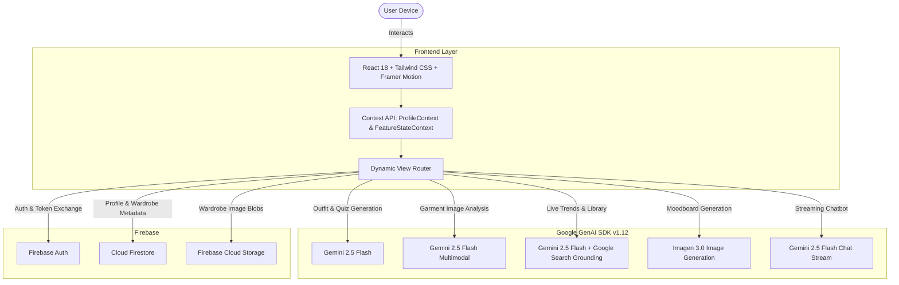

<div align="center">

# ✨ Fashion Fusion

### *Next-Generation Multimodal AI Stylist, Digital Wardrobe & Trend Intelligence Platform*

[](https://www.typescriptlang.org/)
[](https://react.dev/)
[](https://vitejs.dev/)
[](https://tailwindcss.com/)
[](https://aistudio.google.com/)
[](https://firebase.google.com/)
[](https://opensource.org/licenses/MIT)

<p align="center">
  <a href="#-key-features">Key Features</a> •
  <a href="#-architecture--tech-stack">Architecture</a> •
  <a href="#-quick-start">Quick Start</a> •
  <a href="#-environment-variables">Configuration</a> •
  <a href="#-ai-engines--models">AI Engines</a> •
  <a href="#-project-structure">Project Structure</a> •
  <a href="#-contributing">Contributing</a>
</p>

</div>

---

## 🌟 Overview

**Fashion Fusion** is an intelligent personal styling ecosystem that synthesizes state-of-the-art multimodal generative AI, dynamic real-time web trend analysis, and cloud wardrobe management. 

By analyzing your personal mood, target occasion, body silhouette, and existing closet items, Fashion Fusion delivers hyper-personalized outfits paired with photorealistic AI-generated moodboards and shoppable recommendations.

### 💡 Why Fashion Fusion?

* **Context-Aware Styling**: Outfits aren't generic templates — they are dynamically composed based on your mood, body shape, and personal Style DNA.
* **Photorealistic Visualizations**: See the vision before you wear it, powered by **Google Imagen 3**.
* **Wardrobe-First Recommendations**: Upload photos of your clothes; computer vision categorizes them so the stylist builds outfits using garments you already own.
* **Live Market Trend Grounding**: Harnesses Google Search Grounding to curate what's genuinely trending right now in high fashion and streetwear.
* **E-Commerce Localization**: Generates shoppable item links tailored for leading fashion retailers (Myntra, Ajio, Amazon, Flipkart).

---

## 🚀 Key Features

### 1. 🎨 AI Personal Stylist
* **Multimodal Outfit Synthesis**: Generates curated looks combining tops, bottoms, outerwear, footwear, and accessories.
* **Mood & Occasion Engine**: Select emotional vibes (e.g., *Confident, Euphoric, Moody, Minimalist, Chill*) and occasions (e.g., *Date Night, Music Festival, Casual Friday*).
* **Wardrobe Integration Toggle**: Seamlessly mix existing pieces from your digital wardrobe with complementary new items.
* **Flattering Cut Tailoring**: Informs silhouette suggestions based on body profile geometry (*Hourglass, Pear, Apple, Rectangle, Inverted Triangle*).

### 2. 🖼️ Studio Moodboard Generator
* **Editorial-Grade AI Visuals**: Translates outfit compositions into descriptive visual prompts rendered at a high-fashion portrait aspect ratio (3:4) via **Imagen 3**.
* **Download & Share**: Inspect textures, styling layers, lighting, and model aesthetics directly inside the outfit card.

### 3. 👗 Computer Vision Digital Wardrobe
* **Instant Garment Recognition**: Upload a photo of your clothes; **Gemini 2.5 Flash** visually analyzes the image, automatically extracting:
  * Garment classification (*Tops, Bottoms, Outerwear, Dresses, Footwear, Accessories*)
  * Primary and accent color identification
  * Precise stylistic descriptions
* **Cloud Asset Persistence**: Wardrobe photos and metadata sync securely to **Firebase Storage** and **Cloud Firestore**.

### 4. 🧬 Style DNA & Interactive Personality Quiz
* **5-Question Lifestyle & Aesthetic Assessment**: Fun, dynamic quiz assessing your aesthetic tastes, coffee orders, travel preferences, and vibes.
* **Dynamic Archetype Profile**: Computes your signature Style DNA (e.g., *Urban Minimalist, Bohemian Wanderer, Cyber Grunge*) complete with summary traits.
* **Personalized 5-Color Swatch Palette**: Generates exact hex color palettes that complement your aesthetic profile.

### 5. 💬 FusionBot Conversational Stylist
* **Real-Time Streaming Chat**: Fast, streaming conversational guidance for second opinions, event outfit vetting, and fashion tips.
* **Witty & Fashion-Forward Persona**: Combines high-taste critique with encouraging styling advice.

### 6. 📈 Real-Time Trend Pulse
* **Google Search-Grounded Discovery**: Live trend queries retrieved with real-time web grounding via Gemini Tools.
* **Verified Source Citations**: Includes direct clickable citation links to reputable fashion publishers and trend forecasts.

### 7. 📚 Fashion Library & Encyclopedia
* **Curated Style Codex**: Search and explore iconic subcultures, aesthetics, and fashion movements (*Cottagecore, Dark Academia, Streetwear, Old Money, Avant-Garde*).
* **Historical & Cultural Context**: Deep dive into origins, philosophy, and defining silhouettes.
* **Instant Curated Shoppable Capsule**: Automatically builds a shoppable starter pack for any style query.

### 8. 🔐 Authentication & Profile Sync
* **Dual Auth Options**: Secure Email/Password or One-Click Google OAuth Sign-In.
* **Real-Time Profile Storage**: Persistent sync for Style DNA, body profiles, and wardrobe collections across sessions.
* **Admin Analytics Telemetry**: Built-in administration view for platform engagement insights.

---

## 🏗️ Architecture & Tech Stack



### 💻 Technologies Used

| Domain | Technology | Description |
| :--- | :--- | :--- |
| **Frontend Framework** | [React 18.3](https://react.dev/) | Component-driven UI architecture |
| **Language** | [TypeScript 5.8](https://www.typescriptlang.org/) | Full type safety and strict schema validation |
| **Build Tool** | [Vite 6.2](https://vitejs.dev/) | Sub-second HMR and optimized production bundles |
| **Styling & Design** | [Tailwind CSS](https://tailwindcss.com/) + [Syne & Poppins Fonts](https://fonts.google.com/) | Cyber-chic modern styling with dark mode support |
| **Animations** | [Framer Motion 11.2](https://www.framer.com/motion/) | Smooth view transitions, stagger effects, and tactile micro-interactions |
| **Core AI Engine** | [@google/genai 1.12](https://www.npmjs.com/package/@google/genai) | Official Google GenAI SDK for Gemini 2.5 Flash & Imagen 3 |
| **Visual AI** | `imagen-3.0-generate-002` | Generates photorealistic high-resolution fashion editorial imagery |
| **Multimodal Vision** | `gemini-2.5-flash` | Analyzes uploaded clothing photography into structured JSON schema |
| **Web Grounding** | Google Search Tool integration | Live real-time trend pulse queries with citation metadata |
| **Backend & Auth** | [Firebase 10.x / 13.x](https://firebase.google.com/) | Authentication, Firestore NoSQL DB, and Cloud Storage |

---

## 📁 Project Structure

```
fashion-fusion/
├── components/                  # Reusable UI components
│   ├── Footer.tsx               # Application footer with branding
│   ├── Header.tsx               # Navigation bar, user greeting & theme toggles
│   ├── LoadingSpinner.tsx       # Animated custom spinner
│   ├── MoodInput.tsx            # Interactive chip selector for moods & occasions
│   ├── Navigation.tsx           # Mobile & desktop navigation elements
│   ├── OutfitCard.tsx           # Curated outfit display with shoppable items & moodboard
│   ├── Sidebar.tsx              # Primary collapsible navigation sidebar
│   └── tabs/                    # Tabbed subviews for modular feature panels
│       ├── ChatbotTab.tsx
│       ├── StylistTab.tsx
│       ├── TrendsTab.tsx
│       └── WardrobeTab.tsx
├── contexts/                    # Global React Context providers
│   ├── FeatureStateContext.tsx  # Caches active generation results across tab navigation
│   ├── ProfileContext.tsx       # User profile, Style DNA & wardrobe state
│   └── ThemeContext.tsx         # Dark/Light mode theme state
├── features/                    # Core application views & business logic
│   ├── AIStylist.tsx            # Main outfit generation cockpit
│   ├── AdminStats.tsx           # Platform analytics & admin controls
│   ├── Auth.tsx                 # Login & Registration with Email & Google OAuth
│   ├── Dashboard.tsx            # Personalized hub & quick actions
│   ├── DigitalWardrobe.tsx      # Closet manager with vision upload
│   ├── FashionLibrary.tsx       # Encyclopedia with grounded style deep dives
│   ├── FusionBot.tsx            # Conversational streaming AI assistant
│   ├── Profile.tsx              # User preferences, DNA badge & body profile
│   ├── StyleQuiz.tsx            # Interactive 5-step Style DNA questionnaire
│   └── TrendPulse.tsx           # Real-time search-grounded trend feed
├── services/                    # External API & Database integration layers
│   ├── dbService.ts             # Firestore operations, Auth helpers & Storage uploads
│   └── geminiService.ts         # Gemini 2.5 Flash, Imagen 3, & Vision integrations
├── types.ts                     # TypeScript interfaces and data models
├── firebase.ts                  # Firebase app initialization & service exports
├── vite.config.ts               # Vite configuration with env variable proxy
├── tsconfig.json                # TypeScript compiler configuration
├── package.json                 # Dependencies and build scripts
└── .env.example                 # Environment configuration template
```

---

## ⚡ Quick Start

### Prerequisites
Make sure you have the following installed on your machine:
* **Node.js**: v18.0.0 or later (v20+ recommended)
* **npm** or **bun** / **yarn** / **pnpm**
* A **Google Gemini API Key** from [Google AI Studio](https://aistudio.google.com/)

### 1. Clone the Repository
```bash
git clone https://github.com/your-username/fashion-fusion.git
cd fashion-fusion
```

### 2. Install Dependencies
```bash
npm install
```

### 3. Configure Environment Variables
Copy the sample environment file:
```bash
cp .env.example .env.local
```

Open `.env.local` and insert your Gemini API Key:
```env
GEMINI_API_KEY=your_actual_gemini_api_key_here
```

### 4. Run Development Server
```bash
npm run dev
```

The application will start at `http://localhost:3000`.

### 5. Build for Production
To create an optimized production build:
```bash
npm run build
npm run preview
```

---

## ⚙️ Environment Variables

| Variable | Description | Required | Source |
| :--- | :--- | :---: | :--- |
| `GEMINI_API_KEY` | Google Gemini API Key for LLM and image generation | **Yes** | [Google AI Studio](https://aistudio.google.com/) |
| `VITE_FIREBASE_API_KEY` | Firebase Web API Key *(Optional if using default config)* | Optional | Firebase Console |
| `VITE_FIREBASE_PROJECT_ID` | Firebase Project Identifier | Optional | Firebase Console |
| `VITE_FIREBASE_STORAGE_BUCKET`| Firebase Cloud Storage bucket domain | Optional | Firebase Console |

> **Note**: Vite forwards `GEMINI_API_KEY` into `process.env.API_KEY` at compile time via `vite.config.ts`.

---

## 🧠 AI Engines & Models

Fashion Fusion leverages Google's frontier models via the unified `@google/genai` TypeScript SDK:

```typescript
import { GoogleGenAI } from "@google/genai";

const ai = new GoogleGenAI({ apiKey: process.env.API_KEY });
```

### 1. Structured Outfit Curation (`gemini-2.5-flash`)
Employs strict JSON Schema enforcement (`responseSchema`) to guarantee structured JSON output containing:
- Complete look names & atmospheric description
- Specific clothing items with titles, rationale, and localized retailer links
- Comprehensive image generation prompt for Imagen 3

### 2. Studio Moodboard Generation (`imagen-3.0-generate-002`)
- **Aspect Ratio**: 3:4 (Portrait fashion editorial)
- **Output**: Base64 JPEG rendered directly inside the responsive UI

### 3. Clothing Vision Extraction (`gemini-2.5-flash` Multimodal)
- Uploaded clothing photos are encoded as `inlineData` Base64 parts.
- The model classifies items by category (*Tops, Bottoms, Outerwear, Footwear, etc.*) and detects dominant color palettes.

### 4. Real-time Search Grounding (`gemini-2.5-flash` + `googleSearch`)
- Trend and Fashion Library queries utilize the search tool:
  ```typescript
  config: {
    tools: [{ googleSearch: {} }],
  }
  ```
- Extracts grounding metadata and displays authentic verified source links in the UI.

---

## 🔒 Security & Privacy

* **Strict Schema Validation**: Prompts are constrained with schema enforcement to prevent prompt injection and malformed responses.
* **Protected User Storage**: Cloud Firestore and Firebase Storage are segmented by individual authenticated user IDs (`uid`).
* **Environment Integrity**: Secrets are isolated via environment variables and excluded from version control via `.gitignore`.

---

## 🤝 Contributing

Contributions make the open-source community an inspiring place to learn, create, and build. Any contributions you make are **greatly appreciated**.

1. **Fork the Project**
2. **Create your Feature Branch** (`git checkout -b feature/AmazingFeature`)
3. **Commit your Changes** (`git commit -m 'feat: Add some AmazingFeature'`)
4. **Push to the Branch** (`git push origin feature/AmazingFeature`)
5. **Open a Pull Request**

### Code Style Guidelines
- Use TypeScript with explicit types (avoid `any` where possible).
- Utilize Tailwind utility classes for styling.
- Keep components modular and single-responsibility.

---

## 📄 License

Distributed under the **MIT License**. See `LICENSE` for more information.

---

## 💖 Acknowledgments

* [Google AI Studio](https://aistudio.google.com/) for Gemini 2.5 Flash and Imagen 3
* [Firebase](https://firebase.google.com/) for effortless Authentication & Firestore database
* [Tailwind CSS](https://tailwindcss.com/) & [Framer Motion](https://www.framer.com/motion/) for modern design and animation tooling
* [Google Fonts](https://fonts.google.com/) for Syne & Poppins typefaces

<div align="center">
  <sub>Crafted with passion for the intersection of artificial intelligence and personal style.</sub>
</div>
